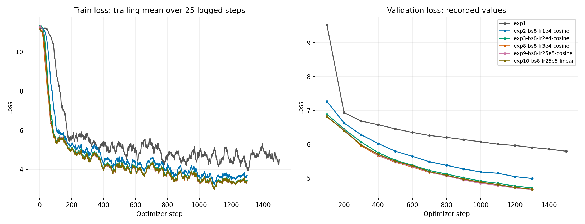
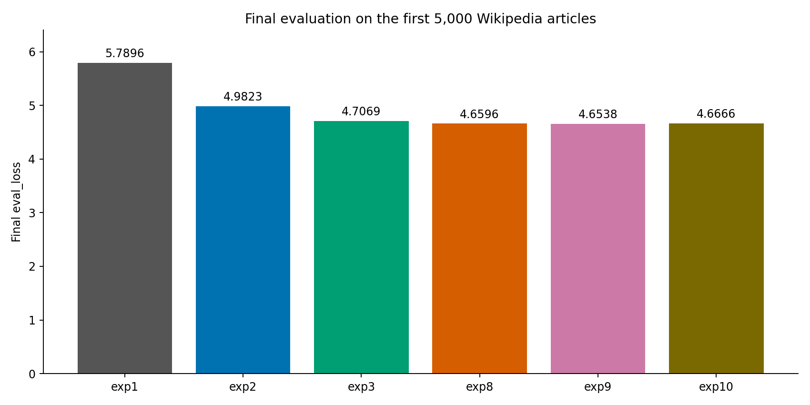

# Мини-претрейн Qwen3 на русской Wikipedia

## Цель

Обучить языковую модель с нуля, посмотреть, как меняется loss, и сравнить
несколько настроек обучения.

В отчёте представлены шесть экспериментов. Для каждого приведены метрики,
графики и полный текст генерации.

## Условия обучения

- Датасет: `wikimedia/wikipedia`, версия `20231101.ru`.
- Первые 5000 статей использованы для проверки качества, остальные 1 940 063 — для обучения.
- Токенизатор: `ai-forever/rugpt3small_based_on_gpt2`.
- Длина текста после токенизации: 512 токенов. Длинные статьи обрезаются, короткие дополняются.
- Модель: Qwen3, 960 881 664 параметра. Архитектура из задания не менялась.
- Обучение с нуля на одной NVIDIA A100 80 GB.
- Во всех экспериментах: оптимизатор `adamw_torch_fused`, `bf16=True`, `tf32=True`,
  `torch_compile=False`, attention SDPA.
- Первые 200 шагов learning rate постепенно увеличивается — это warmup.
- Накопление градиентов (`gradient_accumulation_steps`) равно 1.
- Проверка качества и сохранение модели — каждые 100 шагов.

Лимит обучения задан через callback: 15 минут.
Время проверяется между шагами, поэтому фактическая остановка происходила
через 934–944 секунды. В этот промежуток входят проверки качества и сохранения.
После обучения выбирается лучший сохранённый вариант модели и проводится
финальная проверка на первых 5000 статьях.

## Эксперименты

Менялись batch size, learning rate и scheduler. На остальные гиперпараметры не хватио времени.

| Эксперимент | Batch size | Learning rate | Scheduler | Финальный eval_loss |
| --- | ---: | ---: | --- | ---: |
| exp1 | 4 | 5e-5 | linear | 5.789609 |
| exp2 | 8 | 1e-4 | cosine | 4.982263 |
| exp3 | 8 | 2e-4 | cosine | 4.706926 |
| exp8 | 8 | 3e-4 | cosine | 4.659560 |
| exp9 | 8 | 2.5e-4 | cosine | **4.653807** |
| exp10 | 8 | 2.5e-4 | linear | 4.666598 |

Лучший результат — **exp9: eval_loss = 4.653807163238525**.


## Графики loss



Слева показана ошибка на обучающих текстах, справа — на валидационных.
По горизонтали — шаги обучения. Для удобства чтения train loss усреднён
по последним 25 записям, eval loss показан без сглаживания.

Ошибка быстро снижается в начале, затем падение лосса замедляется.



Графики отдельных экспериментов:

- [Первый эксперимент (exp1)](plots/exp1_loss.png)
- [exp2](plots/exp2_loss.png)
- [exp3](plots/exp3_loss.png)
- [exp8](plots/exp8_loss.png)
- [exp9](plots/exp9_loss.png)
- [exp10](plots/exp10_loss.png)

## Выводы по результатам экспериментов

**Learning rate.** При одинаковых batch size 8 и cosine scheduler увеличение
LR с 1e-4 до 2e-4 снизило eval_loss с 4.982263 до 4.706926.
Лучшие значения получены при LR 2.5e-4 и 3e-4. Их результаты очень близки,
поэтому нельзя уверенно сказать, что один из этих LR лучше другого.

**Batch size.** Использовались значения 4 и 8. Но вместе с batch size менялись
LR и scheduler, поэтому отдельный эффект batch size определить нельзя.

**Scheduler.** При LR 2.5e-4 cosine дал немного меньший loss, чем linear:
4.653807 против 4.666598. Разница небольшая. Кроме того, оба расписания
рассчитаны на целую эпоху, а за короткое обучение LR после warmup почти
не менялся. Этого сравнения недостаточно, чтобы уверенно выбрать лучший scheduler.


Оптимизатор, bf16, tf32, torch_compile и накопление градиентов были одинаковыми
во всех шести экспериментах. Потрогать их не хватило доступного времени на gpu. 
Поэтому их отдельное влияние на результат в этой серии не измерено.

## Примеры генераций

Для всех моделей использован промпт:
`Москва является одним из крупнейших городов`.

Настройки генерации: до 80 новых токенов, temperature 0.8, top_p 0.95.
Ниже приведены полные сгенеренные тексты всех шести экспериментов.
Ошибки, повторы и незаконченные фразы оставлены без исправлений.

### Первый эксперимент (exp1)

```text
Москва является одним из крупнейших городов, чтобы по-й. 

Карьера 
В 2010 году, что в состав: «Н—1928 года», «Уд.
 «Тра», «Иар» и «Науский «У» и «Питал» и «Цлеу».

Список в качестве «Пле-летия»

Известные в 2011
```

### Exp2

```text
Москва является одним из крупнейших городов.

История 
В 1975 году был снят в семье, что его брат, что они не только в качестве. В это же день как у своей страны, и был убит из нескольких лет. В дальнейшем в том, что её ни не смог не было, но не смог удалось, что она не смог не столько в качестве, как это время в случае в неё не имещается в одной
```

### Exp3

```text
Москва является одним из крупнейших городов у них. В его половине XIX века: 

 Селен, О. И. Д. Г. С. Кали. — М.: Госстройков, 1984. — 6 с.
 Ф. П. Длина
 Абилейные исследования — Уланство: Л., Д. М. Шуков,
```

### Exp8

```text
Москва является одним из крупнейших городов, чтобы обрести из его. 
 
В ролях «The Way» — Билли Голбь. К., Очерки В. А. Галивича, А. В. Гелова, Г. Г. Вильева, В. Г. Куденко, В. С. Ломоносова, А. Г
```

### Exp9

```text
Москва является одним из крупнейших городов, и после окончания его пребывания в течение трёх дней в городе Шолк-де, а также в ноябре 1990 года. В октябре 1954 года был членом министра партии «Шеведника». В 1994 году в ходе своей оккупации был награждён орденом Октябрьской Революции (с октября 1942 года), который награждён орденом Отечественной войны.

В 1951 году был награждён награждён орденами Славы 2-го Украинского полка
```

### Exp10

```text
Москва является одним из крупнейших городов, и после окончания войны. 

Карьерации по вопросам, однако, как она стала одной из-за проблем с другими войсками.

В начале войны в марте 1945 года на здании приняли участие в качестве игрока, в том числе не смог арестовать.

Полуфинал в ходе войны 
Основными результатом:


Указомбардир
 Никосп
```

## Выводы по результатам

Каждая настройка запускалась один раз. Маленькая разница между результатами
может быть случайной. Генерации тоже случайные: одного текста недостаточно
для точного сравнения моделей.

В расчёт loss входят и токены, которыми дополняются короткие статьи (padding).
Поэтому снижение ошибки отражает обучение как на тексте, так и на дополнении.
Для всех экспериментов расчёт одинаковый, но значения нельзя считать оценкой
только обычного текста.

Гиперпараметры выбирались по тем же 5000 статьям, на которых измерен финальный
eval_loss. Отдельной дополнительной тестовой выборки не было.

## Выводы

За короткое обучение модель начинает воспроизводить слова, пунктуацию,
заголовки и отдельные языковые конструкции. Loss снижается, но связного
и достоверного текста пока нет.

Лучший результат среди этих запусков получен при batch size 8,
LR 2.5e-4 и cosine scheduler: eval_loss = 4.653807.
Самое заметное улучшение связано с увеличением LR.

Для более точных выводов стоит повторить близкие настройки несколько раз,
отдельно сравнить batch size и настроить scheduler под короткое обучение.
Также нужно исключить padding из расчёта loss.

## Код

[Код обучения](your_solution.py), [Dockerfile](Dockerfile),
[скрипт запуска](run_experiment.sh), [код графиков](plot_losses.py).

Подготовка данных и запуск лучшей настройки на A100:

```bash
docker build -t llm-hw1 .
docker run --rm --gpus all --shm-size=32g \
  -v "$PWD":/app -w /app llm-hw1 python your_solution.py prepare
bash run_experiment.sh exp9
```
